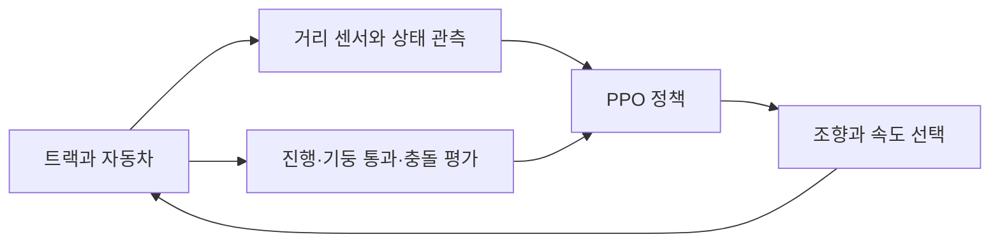

# Future Engineer RL

**Isaac Lab과 PPO로 학습하는 장애물 회피 자율주행 자동차**  
Autonomous driving with obstacle avoidance and curriculum learning in Isaac Lab.

작은 자동차가 사각형 트랙을 돌며 빨간색·초록색 기둥을 정해진 방향으로 통과하도록 학습하는 프로젝트입니다. 자동차는 조향과 속도를 스스로 선택하고, 올바르게 주행하면 보상을 받습니다. 쉬운 코스부터 시작해 성적이 좋아지면 장애물 수와 주행 방향을 바꾸는 **6단계 커리큘럼**을 사용합니다.

> 현재 기본 정책은 **거리 센서와 시뮬레이터 상태를 입력받는 정책**입니다. RGB 카메라가 장면에 정의되어 있지만, 기본 정책에 카메라 영상을 넣지는 않습니다. 학습된 모델 파일은 저장소에 포함하지 않습니다.

## 주요 기능

- **사용자 정의 차량**: URDF와 변환된 USD 모델, 앞바퀴 조향·뒷바퀴 구동
- **Ackermann 조향**: 회전할 때 안쪽과 바깥쪽 바퀴 각도를 다르게 설정
- **주행 관측**: 전방·좌우 거리, IMU 회전 속도, 차량 속도, 가까운 기둥 정보, 트랙 상태
- **PPO 학습**: RSL-RL을 이용한 병렬 환경 학습과 체크포인트 저장·재개
- **커리큘럼**: 완주율과 충돌률 등을 확인해 단계적으로 난이도 상승
- **확인 도구**: 장면 미리보기, 학습 결과 재생, TensorBoard, 영상 기록, 다중 GPU 실행 옵션

## 어떻게 학습하나요?



진행 방향을 기준으로 **빨간 기둥의 오른쪽**, **초록 기둥의 왼쪽**을 통과해야 합니다. 기둥을 올바르게 지나고 한 바퀴를 완주하는 것이 목표이며, 벽·기둥 충돌, 잘못된 쪽으로 통과, 기둥 누락, 장시간 정체는 실패 조건입니다.

| 구성 | 현재 기본 설정 |
| --- | --- |
| 학습 환경 ID | `future_engine_rsl_rl` |
| 트랙 바닥 크기 | 3.2 m × 3.2 m |
| 행동 | 조향과 뒷바퀴 속도, 총 2개 |
| 거리 관측 | 전방 5구간, 왼쪽 3구간, 오른쪽 3구간 |
| 기둥 관측 | 차량 기준 상대 위치, 색, 유효 여부 — 시뮬레이터에서 계산 |
| 추가 관측 | 회전 속도, 전진 속도, 주행 방향, 트랙 중심선 오차, 방향 정렬, 조향각, 이전 행동 |
| 물리 계산 / 행동 주기 | 60 Hz / 30 Hz |
| 에피소드 제한 시간 | 200초 |
| 정책·가치 신경망 | 각각 `[256, 128, 128]`, ELU |
| 학습률 | `1e-4`, 고정 |
| 기본 학습 반복 / 저장 간격 | 15,000회 / 50회 |

설정은 [환경 설정](task/future_engineer/cfg.py)과 [PPO 설정](task/future_engineer/agent/rsl_rl_ppo_cfg.py)에서 바꿀 수 있습니다.

## 실행 환경 준비

이 프로젝트는 **Isaac Sim + Isaac Lab + RSL-RL이 설치된 환경**에서 실행합니다. `pyproject.toml`과 `uv.lock`은 TensorBoard용 의존성만 관리하므로, `uv sync`만으로 시뮬레이터와 학습 환경이 설치되지는 않습니다.

- 실행 예시는 Linux의 Bash 기준입니다.
- 코드에는 Isaac Sim 4.5의 카메라·화면 갱신을 위한 처리가 포함되어 있습니다.
- 저장소의 `.python-version`은 Python 3.10입니다. 실제 Python 버전은 사용하는 Isaac Sim 버전에 맞춰야 합니다.
- 학습 스크립트는 `rsl-rl-lib >= 3.0.1`을 검사합니다. 이 최소 버전 검사만으로 모든 상위 버전의 호환성이 보장되지는 않습니다.
- `isaaclab`, `isaaclab_rl`, `isaaclab_tasks`, `rsl_rl`, PyTorch가 실행 환경에 있어야 합니다.
- GPU·드라이버·운영체제 요구 사항은 선택한 Isaac Sim 버전의 공식 문서를 확인하세요.

설치는 [Isaac Lab 공식 설치 가이드](https://isaac-sim.github.io/IsaacLab/v2.3.2/source/setup/installation/index.html)를 참고하세요. 공식 문서에서도 Isaac Sim 4.x에는 Python 3.10, 5.x에는 Python 3.11을 사용하도록 안내합니다. 패키지는 프로젝트 전용 가상환경이나 Conda 환경에 설치하세요.

### 저장소 받기

```bash
git clone https://github.com/kim-1210/future_engineer_rl.git
cd future_engineer_rl

# 자신의 Isaac Lab 설치 폴더로 바꾸세요.
export ISAACLAB_PATH="/path/to/IsaacLab"

# 이 저장소의 task, robot 모듈을 찾도록 설정합니다.
export PYTHONPATH="$PWD${PYTHONPATH:+:$PYTHONPATH}"
```

이후 명령은 모두 **저장소 최상위 폴더에서**, Isaac Lab 실행 환경을 활성화한 뒤 실행하세요. `ISAACLAB_PATH`는 이 저장소가 아니라 `isaaclab.sh`가 있는 Isaac Lab 폴더를 가리켜야 합니다.

차량 모델은 저장소에 포함된 `car_description/urdf/car/car.usd`를 사용합니다. 파일 위치는 코드 파일을 기준으로 찾으므로 사용자 PC의 폴더 이름을 코드에 넣을 필요가 없습니다.

## 빠르게 시작하기

### 1. 트랙과 차량 보기

```bash
"${ISAACLAB_PATH}/isaaclab.sh" -p launch/view_scene.py \
  --num_envs 1 \
  --enable_cameras
```

장애물 배치도 확인하려면 4단계로 고정하고 주기적으로 다시 배치할 수 있습니다.

```bash
FUTURE_ENGINEER_CURRICULUM_STAGE_OVERRIDE=4 \
  "${ISAACLAB_PATH}/isaaclab.sh" -p launch/view_scene.py \
  --num_envs 1 \
  --enable_cameras \
  --randomize_obstacles \
  --reset_interval_s 3
```

기본 1단계에는 장애물이 없습니다. `--randomize_obstacles`만 추가하면 기둥이 나타나지 않을 수 있습니다. 이 스크립트는 장면 확인용이며 정책을 학습하거나 자동차를 자율주행시키지는 않습니다.

### 2. 학습 시작

먼저 적은 환경 수로 실행을 확인한 뒤, GPU 메모리에 맞게 `--num_envs`를 늘리세요.

```bash
"${ISAACLAB_PATH}/isaaclab.sh" -p launch/rsl_rl_train.py \
  --task future_engine_rsl_rl \
  --num_envs 64 \
  --seed 42 \
  --max_iterations 15000 \
  --disable_front_camera
```

기본 학습은 화면 없이 실행됩니다. 현재 정책은 RGB 영상을 사용하지 않으므로 카메라를 끄고 학습할 수 있습니다. 화면을 보려면 `--ui`를 추가하세요. 현재 구현은 `--ui` 사용 시 시뮬레이션과 정책을 CPU로 전환하므로 환경 수를 1~4개 정도로 줄여 확인하세요.

### 3. 저장한 모델로 주행 보기

`RUN_DIRECTORY`와 `model_1000.pt`를 실제 학습 결과의 폴더·파일 이름으로 바꾸세요.

```bash
"${ISAACLAB_PATH}/isaaclab.sh" -p launch/rsl_rl_play.py \
  --task future_engine_rsl_rl \
  --num_envs 1 \
  --ui \
  --enable_cameras \
  --curriculum_stage 4 \
  --checkpoint "logs/rsl_rl/future_engineer_task/RUN_DIRECTORY/model_1000.pt"
```

재생 단계는 `--curriculum_stage 1`~`6`으로 명시하는 것이 좋습니다. 현재 재생 코드는 체크포인트의 반복 횟수를 읽지만, 성적 기반 커리큘럼의 단계와 이력을 그대로 복원하지는 않습니다.

체크포인트를 지정하지 않았고 저장된 모델도 없으면 **학습하지 않은 무작위 정책**으로 실행됩니다. 또한 요청한 파일이 없고 같은 폴더에 다른 체크포인트가 있으면 가까운 번호의 모델을 선택할 수 있으므로, 출력되는 실제 로드 경로를 확인하세요.

### 4. 이어서 학습

```bash
"${ISAACLAB_PATH}/isaaclab.sh" -p launch/rsl_rl_train.py \
  --task future_engine_rsl_rl \
  --num_envs 64 \
  --disable_front_camera \
  --resume \
  --load_run RUN_DIRECTORY \
  --checkpoint model_1000.pt \
  --curriculum_stage 4 \
  --max_iterations 5000
```

재개할 때 `--load_run`은 실험 폴더 아래의 실행 폴더 이름, `--checkpoint`는 그 안의 파일 이름입니다. 학습의 `--curriculum_stage`는 **시작 단계**를 정하며, 이후 성적에 따라 더 높은 단계로 올라갈 수 있습니다. 재개의 `--max_iterations`는 추가 학습 반복 수로 전달됩니다.

## 커리큘럼

| 단계 | 장애물 구성 | 주행 방향 |
| --- | --- | --- |
| 1 | 없음 | 반시계 방향 |
| 2 | 빨강 또는 초록 1개, 색 선택 확률 50:50 | 반시계 방향 |
| 3 | 빨강 1개 + 초록 1개 | 반시계 방향 |
| 4 | 총 1~3개, 색 무작위 | 반시계 방향 |
| 5 | 총 6~8개를 목표로 배치, 한 변 최대 2개 | 반시계 방향 |
| 6 | 총 6~8개를 목표로 배치, 한 변 최대 2개 | 시계 / 반시계 방향 50:50 |

표는 [실제 배치 코드](task/future_engineer/mdp/events.py)를 기준으로 작성했습니다. 기둥 사이 거리와 출발 위치 주변 공간을 확보하기 위해 실제 개수는 목표보다 적을 수 있습니다.

단계는 단순히 시간이 지나면 올라가는 방식이 아닙니다. 기본적으로 최근 4,096개 종료 에피소드의 결과와 해당 단계에서 최소 7,200스텝을 진행했는지 확인하고, 단계별 성적 조건을 연속 3회 만족하면 올라갑니다. 자세한 기준은 [curriculums.py](task/future_engineer/mdp/curriculums.py)에 있습니다.

## 학습 기록과 추가 옵션

학습 결과는 다음 위치에 저장됩니다.

```text
logs/
├── rsl_rl_progress.log
└── rsl_rl/
    └── future_engineer_task/
        └── YYYY-MM-DD_HH-MM-SS[_run_name]/
            ├── model_*.pt
            ├── params/
            └── ...  # TensorBoard 이벤트, 영상 등
```

TensorBoard만 별도 가상환경에서 실행하려면 다음 명령을 사용할 수 있습니다. 이 환경은 학습용 Isaac Lab 환경과 별개입니다.

```bash
uv sync --locked
uv run --no-sync tensorboard --logdir logs/rsl_rl --host 127.0.0.1
```

브라우저에서 `http://localhost:6006`을 열어 학습 곡선을 확인합니다.

| 옵션 | 용도 |
| --- | --- |
| `--run_name NAME` | 학습 실행 폴더에 이름 붙이기 |
| `--seed N` | 무작위 초기값 지정 |
| `--video` | 영상 기록, 카메라 자동 활성화 |
| `--enable_cameras` | 카메라 센서 사용, 메모리 사용량 증가 가능 |
| `--camera_width`, `--camera_height`, `--camera_update_period` | 기본 학습 스크립트의 카메라 설정 변경 |
| `--max_steps N` | 재생을 N스텝 뒤 종료 |
| `--debug_play --debug_interval 30` | 재생 중 행동과 차량 움직임 출력 |
| `--real-time` | 재생을 가능한 한 실제 시간 속도에 맞추기 |

재생 시 체크포인트가 있으면 해당 실행 폴더의 `exported/`에 TorchScript와 ONNX 내보내기를 시도합니다. 설치한 RSL-RL 버전과 정책 형식에 따라 내보내기가 생략될 수 있습니다.

### 다중 GPU / SSH 세션

같은 서버의 GPU 0번과 1번을 사용하는 예시입니다. `--ssh_gpu_ids`는 SSH 접속을 생성하는 옵션이 아니라 **현재 서버에서 사용할 물리 GPU 번호**를 지정하는 옵션입니다.

```bash
"${ISAACLAB_PATH}/isaaclab.sh" -p launch/rsl_rl_train.py \
  --task future_engine_rsl_rl \
  --num_envs 64 \
  --disable_front_camera \
  --distributed \
  --ssh_gpu_ids 0,1
```

이 옵션은 내부에서 `torch.distributed.run`을 호출합니다. 별도로 `torchrun`으로 감싸지 마세요. `--num_envs`는 각 작업 프로세스에 적용되며, 다중 GPU 학습에는 `--ui`를 함께 사용하지 마세요.

## 폴더 구조

```text
future_engineer_rl/
├── task/
│   ├── __init__.py                 # Gymnasium 환경 등록
│   ├── future_engineer/            # 현재 기본 환경
│   │   ├── cfg.py                  # 센서·관측·행동·보상·종료 조건
│   │   ├── scene.py                # 트랙과 기둥 생성
│   │   ├── agent/rsl_rl_ppo_cfg.py  # PPO 설정
│   │   └── mdp/                    # 관측, 행동, 보상, 리셋, 커리큘럼
│   └── prev_future_engineer/       # 이전 환경 구현
├── robot/future_engineer_car.py    # 차량 USD와 액추에이터 설정
├── car_description/urdf/           # URDF와 실행에 사용하는 USD 파일
├── launch/
│   ├── view_scene.py              # 장면 미리보기
│   ├── rsl_rl_train.py            # 기본 학습 및 다중 GPU 실행
│   ├── rsl_rl_play.py             # 저장된 모델 재생
│   ├── rsl_rl_train_ssh.py        # 별도로 남아 있는 SSH 학습 스크립트
│   └── cli_args.py                # 공통 명령행 인자
├── main.py                        # 초기 생성 예제, 학습 진입점 아님
├── pyproject.toml                 # TensorBoard용 프로젝트 의존성
└── uv.lock
```

이전 환경은 `prev_future_engine_rsl_rl`로 등록되어 있습니다. 기본 사용 예시는 `future_engine_rsl_rl`용이며, 이전 환경은 관측 구성과 카메라 요구가 다를 수 있습니다.

## 실행이 안 될 때

| 증상 | 확인할 내용 |
| --- | --- |
| `No module named 'task'` 또는 `'robot'` | 저장소 루트에서 실행하고 `PYTHONPATH`를 설정했는지 확인 |
| `No module named 'isaaclab'` | TensorBoard용 `.venv`가 아니라 Isaac Lab이 설치된 실행 환경인지 확인 |
| GPU 메모리 부족 | `--num_envs`를 줄이고 기본 학습에서는 `--disable_front_camera` 사용 |
| 재생·장면 보기에서 카메라 활성화 오류 | `--enable_cameras` 추가 |
| 화면에서 움직임이 보이지 않음 | 학습·재생에서 `--ui` 사용, 적은 환경 수로 CPU 화면 갱신 확인 |
| 장애물이 보이지 않음 | 기본 1단계에는 장애물이 없음. 재생 단계 또는 장면 보기의 단계 환경변수 확인 |
| 모델이 기대와 다르게 주행함 | 실제로 불러온 체크포인트, 정책 관측 구성, 재생 단계를 확인 |

## 공개 범위와 참고 자료

소스 코드와 차량 모델을 포함합니다. 학습 기록, 체크포인트, 내보낸 정책, 가상환경, 개인 편집기 설정은 `.gitignore`로 제외합니다. 이 저장소는 학습 환경과 실행 코드를 제공하며, 학습 성능 수치나 실제 차량 주행 성능을 보장하는 벤치마크는 포함하지 않습니다.

- [Isaac Lab](https://github.com/isaac-sim/IsaacLab): 로봇 시뮬레이션과 강화학습 환경
- [RSL-RL](https://github.com/leggedrobotics/rsl_rl): PPO 학습 라이브러리
- [타사 코드 고지](THIRD_PARTY_NOTICES.md): Isaac Lab에서 가져온 코드의 저작권 및 라이선스
